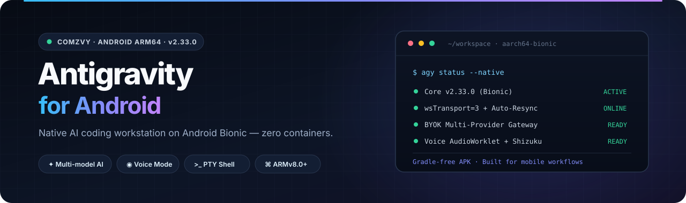
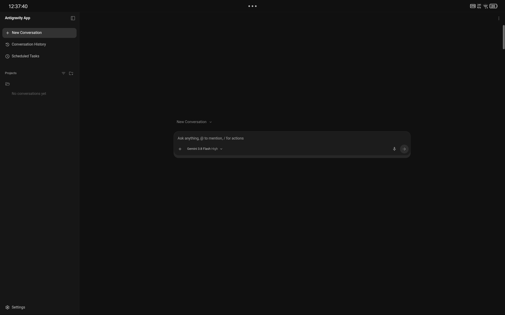
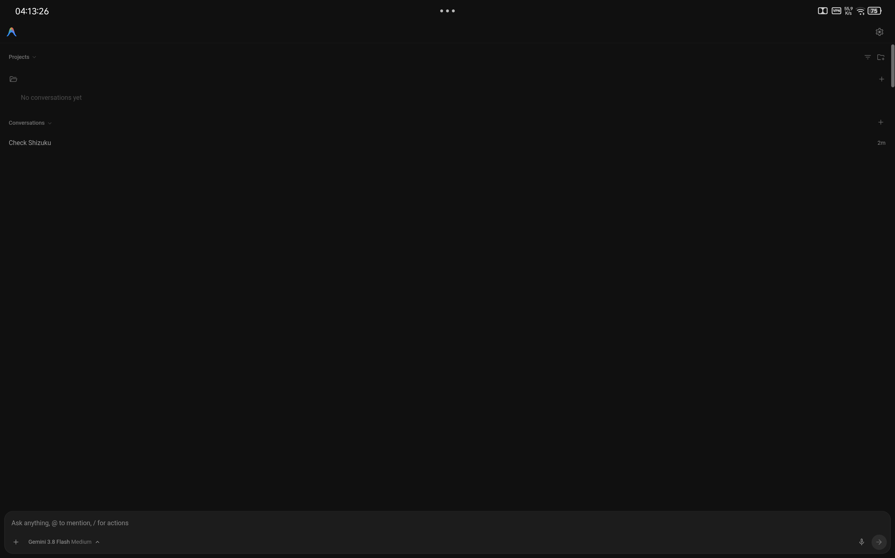
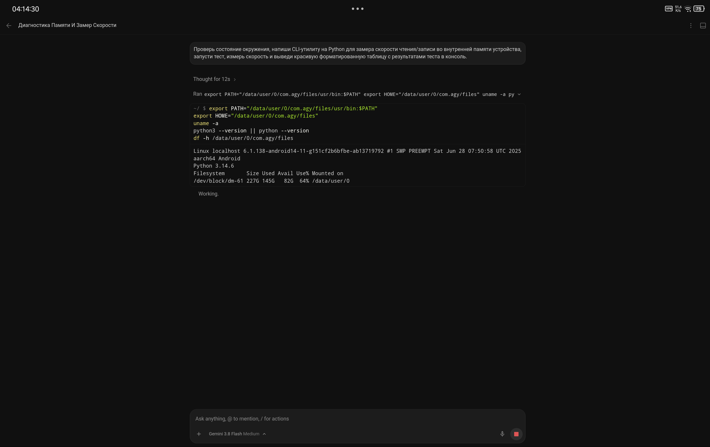
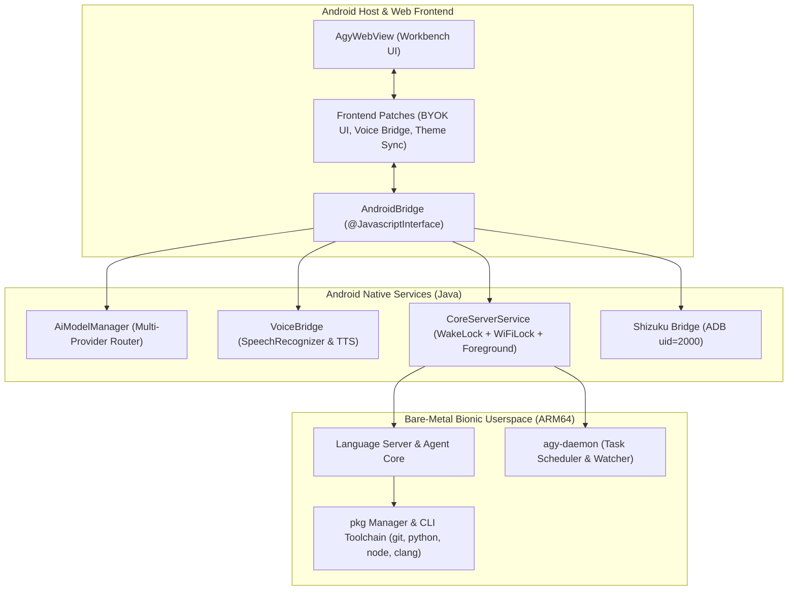

<div align="center">

  

  <br/>

  [](https://android.com)
  [](https://arm.com)
  [](#multi-provider-ai-models--api-key-gateway-byok)
  [](LICENSE)

  <p>
    <a href="https://github.com/Comzvy/antigravity-arm64-android/releases/latest"><strong>⬇ Get the latest APK</strong></a>
    &nbsp; · &nbsp;
    <a href="#quick-start--installation">Installation guide</a>
    &nbsp; · &nbsp;
    <a href="#building-from-source">Build from source</a>
  </p>

</div>

> Turn your Android device into a self-contained AI engineering workstation. Ported from **Antigravity v2.33.0 Linux ARM64** (`go1.28-20261102-RC00`), running directly in **native Android Bionic userspace**—no PRoot or chroot—while bringing multi-provider AI, voice controls, and a mobile-first interface.

**Explore:** [Highlights](#whats-new-in-this-edition) · [AI providers](#multi-provider-ai-models--api-key-gateway-byok) · [Voice](#native-voice-to-text--speech-synthesis) · [Mobile UX](#android-mobile-ui--ux-optimizations) · [Architecture](#system-architecture)

---

## Why This Edition?

**Antigravity Android** turns your Android device into a self-contained AI software engineering workstation. It runs **directly in native Android Bionic userspace**—without a PRoot or chroot container—so the development environment is built for Android and ARM64 from the ground up.

This edition adds a polished mobile workflow, multi-provider AI, voice interaction, and background execution to the core engine.

<picture>
  <source media="(prefers-color-scheme: dark)" srcset="docs/assets/hero_dark.png">
  <source media="(prefers-color-scheme: light)" srcset="docs/assets/hero_light.png">
  
</picture>

### A quick look

<table>
  <tr>
    <td align="center" width="33%">
      <picture>
        <source media="(prefers-color-scheme: dark)" srcset="docs/assets/workspace_dark.png">
        <source media="(prefers-color-scheme: light)" srcset="docs/assets/workspace_light.png">
        
      </picture>
      <sub><strong>Workspace</strong><br/>Projects and files at a glance</sub>
    </td>
    <td align="center" width="33%">
      <picture>
        <source media="(prefers-color-scheme: dark)" srcset="docs/assets/demo_exec_dark.png">
        <source media="(prefers-color-scheme: light)" srcset="docs/assets/demo_exec_light.png">
        
      </picture>
      <sub><strong>Agent workflow</strong><br/>Run tools in the integrated environment</sub>
    </td>
    <td align="center" width="33%">
      <picture>
        <source media="(prefers-color-scheme: dark)" srcset="docs/assets/settings_desktop_mode_dark.png">
        <source media="(prefers-color-scheme: light)" srcset="docs/assets/settings_desktop_mode_light.png">
        
      </picture>
      <sub><strong>Made for Android</strong><br/>Tune the interface for your device</sub>
    </td>
  </tr>
</table>

---

## What's New in This Edition

| Enhancement | Capability | Key Implementation |
| :--- | :--- | :--- |
| **Multi-Provider AI Gateway (BYOK)** | Use your own API keys across **Google Gemini**, **OpenAI**, **Anthropic Claude**, **OpenRouter**, **Groq**, **DeepSeek**, or custom OpenAI-compatible endpoints. | [`AiModelManager.java`](app/src/main/java/com/agy/ai/AiModelManager.java), [`ai_models/`](web/src/patches/ai_models/) |
| **Native Voice-to-Text & TTS** | Real-time streaming speech recognition (`SpeechRecognizer`), `RecognizerIntent` dialog fallback, cloud Whisper/Gemini audio transcription, and native `TextToSpeech`. | [`VoiceBridge.java`](app/src/main/java/com/agy/voice/VoiceBridge.java), [`voice_input/`](web/src/patches/voice_input/) |
| **Android Mobile UI/UX Suite** | Native tactile haptic feedback, responsive bottom-sheet modals, live Voice HUD, soft-keyboard viewport inset handling, and smart double-back exit guard. | [`mobile-ux.js`](web/src/patches/web_optimizations/mobile-ux.js), [`BackNavigator.java`](app/src/main/java/com/agy/ui/lifecycle/BackNavigator.java) |
| **Dynamic System Theme Sync** | Instant, flicker-free synchronization with Android Dark / Light system modes (`UiModeManager` + `Configuration.UI_MODE_NIGHT_MASK` + WebView `prefers-color-scheme`). | [`MainActivity.java`](app/src/main/java/com/agy/ui/MainActivity.java), [`theme_sync/`](web/src/patches/theme_sync/) |
| **Keep Screen Awake** | Hardware `FLAG_KEEP_SCREEN_ON` automatically keeps the display active while the IDE is open in the foreground. | [`MainActivity.java`](app/src/main/java/com/agy/ui/MainActivity.java) |
| **Lockscreen & Background Persistence** | Continues executing builds, terminal commands, and AI agent tasks when the app is minimized or the device screen is locked (`PARTIAL_WAKE_LOCK` + `WIFI_MODE_FULL_LOW_LATENCY`). | [`CoreServerService.java`](app/src/main/java/com/agy/core/CoreServerService.java), [`WebViewFactory.java`](app/src/main/java/com/agy/ui/webview/WebViewFactory.java) |

---

## Multi-Provider AI Models & API Key Gateway (BYOK)

No longer restricted to a single default backend—switch between leading frontier models directly from **Settings ➔ AI Models & API Keys** or via the floating quick-access button (`🔑`).

* **Supported Providers Out of the Box:**
  * **Google Gemini** (`gemini-2.5-pro`, `gemini-2.5-flash`, `gemini-2.0-flash`)
  * **OpenAI** (`gpt-4o`, `gpt-4o-mini`, `o3-mini`)
  * **Anthropic Claude** (`claude-3-7-sonnet-latest`, `claude-3-5-sonnet-latest`, `claude-3-5-haiku-latest`)
  * **OpenRouter** (Unified access to DeepSeek R1, Claude, Gemini, Llama, Qwen)
  * **Groq** (`llama-3.3-70b-versatile`, `deepseek-r1-distill-llama-70b`, `whisper-large-v3-turbo`)
  * **DeepSeek** (`deepseek-chat`, `deepseek-reasoner`)
  * **Custom Endpoint** (Any local Ollama, vLLM, LiteLLM, or OpenAI-compatible server)
* **On-Device Key Vault:** API keys are stored locally in private app preferences (`agy_ai_models_prefs`) and routed through the native `AndroidBridge` HTTP client to bypass WebView CORS restrictions.

---

## Native Voice-to-Text & Speech Synthesis

Speak your prompts and instructions naturally using a multi-layered voice pipeline engineered specifically for Android WebView:

1. **Primary Tier — Native Android `SpeechRecognizer`:**
   Streams live partial and final transcripts directly into the active chat input or editor (`EXTRA_PARTIAL_RESULTS`), complete with automatic multi-sentence session continuation.
2. **Secondary Tier — System `RecognizerIntent` Dialog:**
   Automatically engages if background recognizer services are restricted by the OEM ROM.
3. **Tertiary Tier — WebAudio + Cloud Whisper / Gemini Multimodal:**
   Captures 16 kHz mono PCM WAV via `AudioContext` and transcribes through **Groq Whisper**, **OpenAI Whisper**, or **Google Gemini Audio** when native Google Speech Services are unavailable.
4. **Native Text-to-Speech (`TextToSpeech`):**
   Exposes `window.speechSynthesis` and `AndroidBridge.speakText()` for vocalizing assistant responses.
5. **Floating Live Voice HUD:**
   Displays a pulsing real-time status & live partial transcript pill at the bottom of the screen whenever the microphone is active.

---

## Android Mobile UI & UX Optimizations

Engineered specifically for responsive touch workflows on Android phones, foldables, and tablets:

* **Native Tactile Haptic Feedback (`AndroidBridge.performHapticFeedback`):**
  Delivers subtle hardware key-tap vibrations (`HapticFeedbackConstants.KEYBOARD_TAP`) and micro-scale touch animations (`scale(0.96)`) across buttons, tabs, menus, and toolbar actions.
* **Smart Hardware Back Navigation & Exit Guard (`BackNavigator.java` & `mobile-ux.js`):**
  Pressing or swiping Android **Back** intelligently closes open modals/dialogs (such as the AI Models manager or Radix popovers) or unfocuses active inputs first, and requires a **double-back press within 2 seconds** (with a native Toast prompt) before minimizing the app.
* **Responsive Bottom-Sheet Modals & Safe-Area Insets:**
  Complex configuration dialogs automatically adapt into smooth, thumb-friendly **Android Bottom Sheets** with drag-pill handles on mobile viewports (`<= 640px`), respecting `--agy-vvh` and `--agy-kb-inset` when the soft keyboard opens.

---

## System Architecture



### Core Engine Capabilities

* **Bare-Metal Execution:** Runs directly in Android's native Bionic environment with `liblse_compat.so` atomic instruction emulation for universal ARMv8.0-A+ compatibility.
* **Elevated System Operations (`rish`):** Native integration with **Shizuku** (`uid=2000`) for silent APK installation, `logcat` inspection, and system diagnostics without requiring root.
* **Fast Built-In Package Manager (`pkg`):** Install `git`, `python`, `nodejs`, `clang`, and CLI utilities directly inside `$PREFIX/bin`.
* **Background Micro-Daemon (`agy-daemon`):** Lightweight scheduler (<10 MB RAM) supporting cron jobs, file watchers, battery triggers, and native Android status bar notifications (`agy-notify`).
* **Self-Hosted APK Builder:** Compiles, dexes, packages, aligns, and signs release APKs directly on the Android device without Gradle (`modules/builder`).

---

## Quick Start & Installation

1. **Install the APK:**
   Build from source or grab the latest APK from [Releases](https://github.com/Comzvy/antigravity-arm64-android/releases):
   * `antigravity.apk` — Standard release.
   * `antigravity-region-bypass.apk` — Release with region/account eligibility check bypass.
2. **Grant Permissions:**
   * **All Files Access** (`MANAGE_EXTERNAL_STORAGE`) for workspace read/write in `/storage/emulated/0/Documents/`.
   * **Microphone Permission** (`RECORD_AUDIO`) when using Voice-to-Text.
   * *(Optional)* Start **Shizuku** for elevated ADB shell capabilities.
3. **Bootstrap CLI Toolchain:**
   Open the integrated terminal and install core development packages:
   ```bash
   pkg update && pkg install git python nodejs bash
   ```
4. **Configure AI Provider (Optional BYOK):**
   Open **Settings ➔ AI Models & API Keys** (or tap the `🔑` button) to configure your preferred provider and API key.

---

## Building from Source

Antigravity includes a standalone, Gradle-free build pipeline (`modules/builder`) that runs both on Linux hosts and directly on Android ARM64 devices:

```bash
# Build standard release APK (outputs to dist/antigravity.apk):
bash build.sh

# Build release APK with region bypass (outputs to dist/antigravity-region-bypass.apk):
bash build.sh --region-bypass

# Rebuild frontend web bundle and verify patches:
bash web/build.sh && bash web/tests/selftest.sh

# Run full modular test suite across all 6 subsystems:
bash test_all_modules.sh
```

---

## Repository Layout

```text
antigravity-android/
├── app/                  # Android native host (Activities, WebView, AI Router, VoiceBridge, Service)
├── web/                  # Workbench frontend, modular JS patch system (ai_models, voice_input, theme_sync)
├── modules/              # Decoupled core subsystems with independent test suites
│   ├── builder/          # Gradle-free APK build pipeline (aapt, javac, d8, zipalign, apksigner)
│   ├── core/             # Runtime extraction, glibc/bionic shims, SHA-256 verification
│   ├── env/              # Environment path resolver, flight recorder diagnostics, CLI wrappers
│   ├── io/               # Event broker, FIFO IPC pipes, and socket streams
│   ├── patches/          # ELF binary patchers (PTY shell path, syscall emulation, SIGILL handler)
│   └── runner/           # Process supervisor, port readiness probes, E2E test harness
├── env/                  # Bionic userspace scripts, pkg manager, agy-daemon, liblse_compat
├── config/               # Global constants, path definitions, and default agent rules
├── docs/assets/          # Custom SVG banners, UI screenshots, and visual assets
├── build.sh              # Top-level APK build entrypoint
└── test_all_modules.sh   # Automated test runner for all modules
```

> [!TIP]
> Detailed technical documentation is maintained inside each subsystem directory: [`app/README.md`](app/README.md), [`web/README.md`](web/README.md), [`env/README.md`](env/README.md), and [`modules/*/README.md`](modules/).

---

<div align="center">
  <sub>Maintained in <a href="https://github.com/Comzvy/antigravity-arm64-android">Comzvy/antigravity-arm64-android</a> &bull; Licensed under the <a href="LICENSE">Apache License 2.0</a></sub>
</div>
