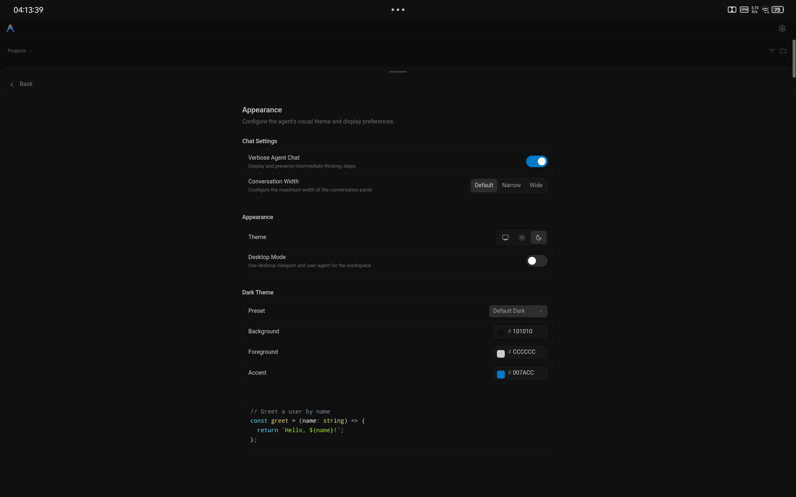
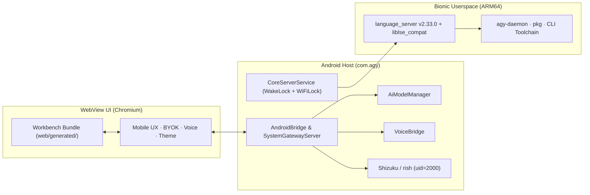

<div align="center">

  

  <br/>

  [](https://github.com/Comzvy/antigravity-arm64-android/releases/latest)
  [](https://android.com)
  [](https://arm.com)
  [](LICENSE)

  <p>
    <a href="https://github.com/Comzvy/antigravity-arm64-android/releases/latest"><strong>Download APK</strong></a>
    &nbsp;·&nbsp;
    <a href="#quick-start">Quick Start</a>
    &nbsp;·&nbsp;
    <a href="#capabilities">Capabilities</a>
    &nbsp;·&nbsp;
    <a href="#building-from-source">Build from Source</a>
    &nbsp;·&nbsp;
    <a href="RELEASE_NOTES.md">Release Notes</a>
  </p>

</div>

**Antigravity for Android** ports **Antigravity v2.33.0 (Linux ARM64)** directly to **native Android Bionic userspace**—with no PRoot or chroot container—paired with a multi-provider AI gateway, voice mode, built-in web terminal, and mobile-first UX.

---

## Preview

<picture>
  <source media="(prefers-color-scheme: dark)" srcset="docs/assets/hero_dark.png">
  <source media="(prefers-color-scheme: light)" srcset="docs/assets/hero_light.png">
  
</picture>

<details>
  <summary><strong>More screenshots (Workspace, Agent Terminal, Display Settings)</strong></summary>
  <br/>
  <table>
    <tr>
      <td align="center" width="33%">
        <picture>
          <source media="(prefers-color-scheme: dark)" srcset="docs/assets/workspace_dark.png">
          <source media="(prefers-color-scheme: light)" srcset="docs/assets/workspace_light.png">
          
        </picture>
        <sub><strong>Workspace</strong><br/>Projects &amp; files</sub>
      </td>
      <td align="center" width="33%">
        <picture>
          <source media="(prefers-color-scheme: dark)" srcset="docs/assets/demo_exec_dark.png">
          <source media="(prefers-color-scheme: light)" srcset="docs/assets/demo_exec_light.png">
          
        </picture>
        <sub><strong>Agent Execution</strong><br/>Integrated tools &amp; shell</sub>
      </td>
      <td align="center" width="33%">
        <picture>
          <source media="(prefers-color-scheme: dark)" srcset="docs/assets/settings_desktop_mode_dark.png">
          <source media="(prefers-color-scheme: light)" srcset="docs/assets/settings_desktop_mode_light.png">
          
        </picture>
        <sub><strong>Settings</strong><br/>Theme &amp; desktop mode</sub>
      </td>
    </tr>
  </table>
</details>

---

## Capabilities

| Area | Highlights | Key Files |
| :--- | :--- | :--- |
| **Native Bionic Core** | Runs Antigravity `v2.33.0` (`language_server`) natively via `ld-linux-aarch64.so.1` with `liblse_compat.so` (ARMv8.0-A LSE/RDM/FCMA emulation), `wsTransport=3` multiplexing, and stream auto-resync. | [`AppLoader.java`](app/src/main/java/com/agy/ui/webview/AppLoader.java), [`modules/patches/`](modules/patches/) |
| **Multi-Provider AI (BYOK)** | Configure **Google Gemini**, **OpenAI**, **Anthropic Claude** (including custom Anthropic endpoints), **OpenRouter**, **Groq**, **DeepSeek**, or custom OpenAI-compatible servers via **Settings ➔ AI Models & API Keys** (`🔑`). | [`AiModelManager.java`](app/src/main/java/com/agy/ai/AiModelManager.java), [`ai_models_menu/`](web/src/patches/ai_models_menu/) |
| **Voice Mode & Audio** | Real-time `SpeechRecognizer`, `RecognizerIntent` fallback, 16 kHz PCM WebAudio `AudioWorklet` capture for cloud Whisper/Gemini transcription, native `TextToSpeech`, and live floating Voice HUD. | [`VoiceBridge.java`](app/src/main/java/com/agy/voice/VoiceBridge.java), [`voice_input/`](web/src/patches/voice_input/) |
| **Web Terminal & CLI** | Built-in PTY web terminal (`$PREFIX/bin/bash` ➔ `runtime/bin/bash` ➔ `/system/bin/sh`), fast `pkg` package manager (`git`, `python`, `nodejs`, `clang`), and `agy-daemon` background scheduler. | [`modules/patches/`](modules/patches/), [`env/`](env/) |
| **Android Mobile UX** | Dynamic Dark/Light theme sync, Keep Screen Awake, `PARTIAL_WAKE_LOCK` + `WIFI_MODE_FULL_LOW_LATENCY` lockscreen persistence, universal media/file picker, haptics, bottom-sheet modals, and double-back guard. | [`MainActivity.java`](app/src/main/java/com/agy/ui/MainActivity.java), [`mobile-ux.js`](web/src/patches/web_optimizations/mobile-ux.js), [`BackNavigator.java`](app/src/main/java/com/agy/ui/lifecycle/BackNavigator.java) |
| **System & Shizuku Bridge** | Elevated ADB shell (`rish`, `uid=2000`) via Shizuku, hardware Torch bridge (`torch on/off`), Android notifications (`agy-notify`), and one-tap crash/startup log export. | [`RishExecutor.java`](app/src/main/java/com/agy/shell/RishExecutor.java), [`CoreServerService.java`](app/src/main/java/com/agy/core/CoreServerService.java) |

---

## Quick Start

1. **Install the APK:** Download `antigravity.apk` from the [latest release](https://github.com/Comzvy/antigravity-arm64-android/releases/latest) (optionally verify with `SHA256SUMS.txt`).
2. **Grant Permissions:**
   - **All Files Access** (`MANAGE_EXTERNAL_STORAGE`) for workspace access under `/storage/emulated/0/Documents/`.
   - **Microphone** (`RECORD_AUDIO`) if using Voice Mode.
   - *(Optional)* Enable **Shizuku** for elevated ADB (`rish`) commands.
3. **Install CLI Packages:** Open the built-in terminal and bootstrap tools:
   ```bash
   pkg update && pkg install git python nodejs bash
   ```
4. **Configure AI Providers (Optional):** Open **Settings ➔ AI Models & API Keys** (or tap `🔑`) to add your API keys or custom endpoints.

---

## Architecture



---

## Building from Source

Antigravity uses a standalone, Gradle-free build pipeline (`modules/builder`) that runs on Linux hosts or directly on Android ARM64 devices:

```bash
# Build standard release APK (dist/antigravity.apk):
bash build.sh

# Build debuggable dev APK (dist/antigravity-dev.apk):
bash build.sh --dev

# Rebuild frontend web bundle and run web self-tests:
bash web/build.sh && bash web/tests/selftest.sh

# Run full modular test suite across all 6 subsystems:
bash test_all_modules.sh
```

---

## Repository Structure

```text
antigravity-arm64-android/
├── app/                  # Android native host (Activities, WebView, AI Router, VoiceBridge, Services)
├── web/                  # Workbench UI, patch_main.py, modular JS patches (ai_models_menu, voice_input, theme_sync)
├── modules/
│   ├── builder/          # Gradle-free APK pipeline (aapt, javac, d8, zipalign, apksigner)
│   ├── core/             # Runtime extraction, glibc/bionic shims, SHA-256 verification
│   ├── env/              # Path resolver, diagnostics, CLI wrappers
│   ├── io/               # Event broker, FIFO IPC, socket streams
│   ├── patches/          # ELF binary patchers (PTY shell, syscalls, SIGILL/LSE, nosandbox)
│   └── runner/           # Process supervisor, readiness probes, E2E harness
├── env/                  # Bionic userspace scripts, pkg manager, agy-daemon, liblse_compat
├── config/               # App version, ports, and runtime constants (app.env)
├── docs/assets/          # Hero SVG banner and light/dark UI screenshots
├── build.sh              # Top-level APK build entrypoint
└── test_all_modules.sh   # Automated test runner
```

> [!TIP]
> Subsystem documentation is available in [`app/README.md`](app/README.md), [`web/README.md`](web/README.md), [`env/README.md`](env/README.md), and [`modules/`](modules/).

---

<div align="center">
  <sub>Maintained by <a href="https://github.com/Comzvy">Comzvy</a> &bull; Licensed under <a href="LICENSE">Apache-2.0</a></sub>
</div>
